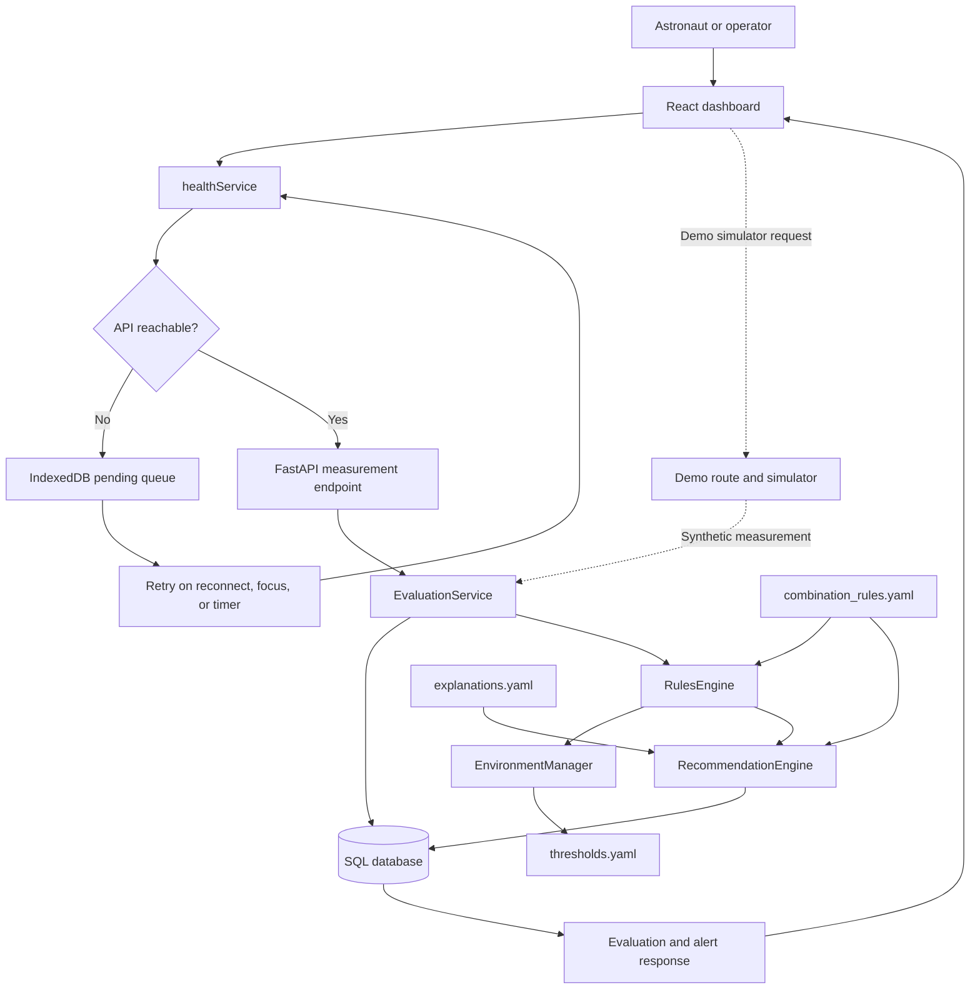

# AstroHealth Companion Architecture

## Overview

AstroHealth Companion is a React and TypeScript frontend connected to a FastAPI backend. The frontend collects and displays astronaut health measurements, stores pending submissions locally when offline, and synchronizes them with the configured API. The backend persists measurements, evaluates health indicators using environment-specific YAML knowledge, and returns evaluations, alerts, and recommendations.

The application currently synchronizes with its configured backend when connectivity is available. The destination is configured through `VITE_API_URL`; this architecture does not represent a flight-grade communications link.

## Project Flow



## Project Structure

Descriptions appear next to each directory and file. Generated or machine-specific artifacts such as `node_modules/`, `.venv/`, `dist/`, caches, and the local SQLite database are intentionally omitted.

```text
.
├── index.html                         — Vite HTML entry point and application metadata.
├── package.json                       — Frontend dependencies and development/build scripts.
├── package-lock.json                  — Locked npm dependency versions.
├── tsconfig.json                      — TypeScript compiler configuration.
├── render.yaml                        — Render deployment configuration for frontend, backend, and database.
├── RUN_DEMO.md                         — English setup and usage instructions for the local demo.
├── FINAL_PROPOSAL.md                  — Jury-facing concept, candidate sensors, and proposed data flow.
├── FRONTEND_BACKEND_INTEGRATION.md    — Explains API configuration and frontend/backend data flow.
├── public/                            — Static files served by the frontend.
│   ├── app-icon.svg                    — Application icon.
│   ├── manifest.webmanifest            — Progressive Web App metadata.
│   └── sw.js                          — Service worker for offline app-shell support.
├── src/                               — Frontend application source.
│   ├── App.tsx                        — Main dashboard and app-level data, sync, and demo orchestration.
│   ├── main.tsx                       — React entry point; mounts the app and registers the service worker.
│   ├── styles.css                     — Global application styles.
│   ├── vite-env.d.ts                  — Vite environment type declarations.
│   ├── types/                         — Shared TypeScript data contracts.
│   │   └── health.ts                  — Health, measurement, recommendation, alert, and body-zone types.
│   ├── services/                      — API communication, data mapping, and local persistence.
│   │   ├── api.ts                     — API base URL, HTTP helpers, and request errors.
│   │   ├── healthService.ts           — Health API operations, measurement syncing, and response mapping.
│   │   └── offlineStorage.ts          — IndexedDB queue for measurements and cache for API responses.
│   ├── stores/                        — Persistent client-side application state.
│   │   ├── useAstronautStore.ts       — Astronaut profile, environment, and gamification state.
│   │   ├── useHealthStore.ts          — Current health snapshot, history, alerts, and recommendations.
│   │   └── useUIStore.ts              — UI-specific state.
│   └── components/                    — Reusable interface components, grouped by feature.
│       ├── layouts/                   — Shared page structure and navigation.
│       │   ├── appShell.tsx           — Main application shell.
│       │   ├── Sidebar.tsx            — Sidebar navigation.
│       │   └── header.tsx             — Application header.
│       ├── dashboard/                 — Health dashboard and visualization components.
│       │   ├── AlertsPanel.tsx         — Displays health alerts.
│       │   ├── AstronautModel3D.tsx    — Renders a 3D astronaut model.
│       │   ├── HealthOverview.tsx      — Summarizes the astronaut's health.
│       │   ├── IndicatorsGrid.tsx      — Displays health indicator cards.
│       │   ├── SensorBodyMap.tsx       — Shows sensor and health status by body area.
│       │   ├── TrendCard.tsx           — Displays an individual health trend.
│       │   └── TrendsChart.tsx         — Charts measurement trends.
│       ├── human-figure/              — Human figure and body-zone health details.
│       │   ├── BodyZone.tsx            — Renders an individual body zone.
│       │   ├── HumanFigure.tsx         — Renders the body-zone overview.
│       │   └── ZoneDetailPanel.tsx     — Shows details for a selected body zone.
│       ├── measurement/               — Measurement entry components.
│       │   ├── CameraInput.tsx         — Camera-based measurement input.
│       │   ├── MeasurementForm.tsx     — Form for entering health measurements.
│       │   └── QuickMeasure.tsx        — Quick measurement entry flow.
│       ├── recommendations/           — Suggested health actions.
│       │   ├── RecommendationCard.tsx  — Displays one recommendation.
│       │   └── RecommendationsList.tsx — Displays a collection of recommendations.
│       ├── gamification/              — Points and reminder UI.
│       │   ├── PointsBadge.tsx         — Displays earned points.
│       │   └── ReminderToast.tsx       — Displays a reminder notification.
│       └── shared/                    — Reusable status and educational UI elements.
│           ├── EducationalTooltip.tsx  — Provides contextual explanations.
│           ├── SeverityIndicator.tsx   — Displays health severity.
│           └── StatusBadge.tsx        — Displays a status label.
└── backend/                           — Python API, evaluation logic, migrations, and tests.
    ├── requirements.txt               — Python dependencies.
    ├── alembic.ini                    — Alembic migration configuration.
    ├── alembic/                        — Database migration environment and history.
    │   ├── env.py                     — Connects Alembic to app settings and SQLAlchemy metadata.
    │   ├── script.py.mako             — Template for generated migration scripts.
    │   ├── README                     — Alembic scaffold notes.
    │   └── versions/                  — Versioned database schema changes.
    │       ├── 7c6d54eaa5b9_initial_schema.py — Creates the initial database schema.
    │       └── 8d4e2f6a1b9c_add_measurement_sync_keys.py — Adds client measurement sync keys.
    ├── app/                           — FastAPI application package.
    │   ├── __init__.py                — Marks the application package.
    │   ├── main.py                    — Creates the API, configures CORS/lifecycle, and registers routes.
    │   ├── api/                       — HTTP endpoints and shared route dependencies.
    │   │   ├── __init__.py            — Marks the API package.
    │   │   ├── deps.py                — Provides database sessions to route handlers.
    │   │   └── routes/                — Resource-specific API endpoints.
    │   │       ├── __init__.py        — Marks the routes package.
    │   │       ├── astronauts.py      — Creates, reads, updates, and deletes astronaut records.
    │   │       ├── measurements.py    — Creates and lists measurements; submissions trigger evaluation.
    │   │       ├── evaluations.py     — Lists, retrieves, filters, and acknowledges alerts/evaluations.
    │   │       ├── environments.py    — Lists supported environments and their thresholds.
    │   │       └── demo.py            — Handles synthetic demo readings; unavailable in production.
    │   ├── core/                      — Configuration, database setup, and evaluation engines.
    │   │   ├── __init__.py            — Marks the core package.
    │   │   ├── config.py              — Loads and validates application settings.
    │   │   ├── database.py            — Configures SQLAlchemy engine, sessions, and table creation.
    │   │   ├── environment_manager.py — Loads environment-specific thresholds.
    │   │   ├── logging_config.py      — Configures application logging.
    │   │   ├── rules_engine.py         — Evaluates indicators and applies combination rules.
    │   │   └── recommendation_engine.py — Builds explanations and prioritized recommendations.
    │   ├── models/                    — SQLAlchemy database models.
    │   │   ├── __init__.py            — Marks the models package.
    │   │   ├── base.py                — Declarative SQLAlchemy base.
    │   │   ├── astronaut.py           — Astronaut database model.
    │   │   ├── measurement.py         — Measurement and synchronization-key models.
    │   │   └── alert.py               — Persisted evaluation and alert model.
    │   ├── schemas/                   — Pydantic request and response schemas.
    │   │   ├── __init__.py            — Marks the schemas package.
    │   │   ├── astronaut.py           — Astronaut request and response schemas.
    │   │   ├── measurement.py         — Measurement request and response schemas.
    │   │   ├── evaluation.py          — Evaluation and indicator-status schemas.
    │   │   ├── recommendation.py      — Recommendation response schema.
    │   │   └── demo.py                — Synthetic demo request schema.
    │   ├── services/                  — Application workflows and side effects.
    │   │   ├── __init__.py            — Marks the services package.
    │   │   ├── evaluation_service.py  — Validates, evaluates, and persists measurements and alerts.
    │   │   ├── demo_simulator.py      — Generates synthetic measurements for demo profiles.
    │   │   └── notification_service.py — Prints evaluation alerts to the backend console.
    │   └── knowledge/                 — YAML-based health knowledge used by the engines.
    │       ├── thresholds.yaml        — Health thresholds for each mission environment.
    │       ├── combination_rules.yaml — Rules combining indicator statuses and selecting recommendations.
    │       └── explanations.yaml       — Indicator explanations and recommendation content.
    └── tests/                         — Backend automated tests.
        ├── test_api.py                — API behavior tests.
        ├── test_evaluation_service.py  — Evaluation workflow tests.
        ├── test_recommendation_engine.py — Recommendation generation tests.
        └── test_rules_engine.py       — Health rule evaluation tests.
```
