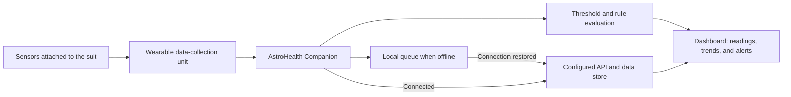

# AstroHealth Companion: Final Proposal

## Proposal Summary

AstroHealth Companion proposes a wearable health-monitoring system for astronauts. Sensors integrated into or attached to the spacesuit would collect selected physiological signals while the astronaut wears it. The software would process the incoming readings, present the astronaut's health status, and raise alerts when measurements meet configured attention or critical conditions.

The goal is to support timely health awareness during a mission. The system is intended as a monitoring and decision-support concept, not as a replacement for medical professionals or established mission procedures.

## The Challenge

Astronauts operate in demanding environments where continuous awareness of health status can be valuable. Periodic measurements may not show how an indicator changes between checks, while monitoring several values manually can make trends and combinations of warning signs harder to identify.

The proposed approach combines wearable sensing with software that organizes readings, evaluates trends and configured thresholds, and makes relevant alerts visible in one dashboard.

## Proposed System

The astronaut wears a suit with sensor modules placed at suitable body locations. A wearable data-collection unit would gather and timestamp measurements, then pass them to AstroHealth Companion through an interface selected during hardware development.

The software would:

- Display current readings, historical trends, and overall status.
- Evaluate measurements against thresholds selected for the mission environment.
- Combine related findings to identify conditions that may deserve attention.
- Present understandable alerts and suggested follow-up actions.
- Store readings locally when a network connection is unavailable and synchronize them when the configured service can be reached.

The actual sampling rate and alert latency would depend on the selected sensors, onboard processing, and available communications.

## Candidate Sensors and Placement

The following are candidate technologies for prototyping and evaluation. Final selection would require engineering review, astronaut testing, and validation for the intended mission and suit.

| Body area | Candidate sensor | Potential contribution | Considerations |
|---|---|---|---|
| Chest | Textile ECG electrodes | Continuous heart rate and rhythm; HRV can be derived from the ECG signal. | Requires stable skin contact and validation under suit movement and environmental conditions. |
| Chest or torso | Respiratory inductance plethysmography (RIP) band | Respiratory rate and breathing pattern. | Adds a respiratory measurement not currently represented in the application. |
| Wrist or upper arm | Optical photoplethysmography (PPG) sensor | Pulse and heart-rate estimates; a pulse oximeter may also estimate oxygen saturation. | Motion and sensor contact can affect signal quality. Oxygen saturation is a potential future metric, not currently part of the application. |
| Upper arm | Oscillometric blood-pressure cuff | Intermittent blood-pressure measurements. | A cuff may be less compatible with suit integration and does not provide continuous measurement. |
| Chest and wrist/arm | ECG plus PPG for experimental pulse-transit-time estimation | A possible research path for cuffless blood-pressure estimates. | This is not a validated substitute for a blood-pressure cuff without appropriate calibration and clinical validation; PPG alone does not reliably measure blood pressure. |
| Torso or another validated skin-contact site | Thermistor or resistance temperature detector (RTD) | Skin-temperature measurement. | Skin temperature is not the same as core body temperature; the distinction must be clear in the interface. |
| Upper arm or abdomen | Continuous glucose monitor (CGM) | Glucose estimates from interstitial fluid using a small subcutaneous filament. | It is not a non-invasive optical patch; placement, sensor lag, calibration, and device constraints must be considered. |
| Head | EEG electrodes | Brain electrical activity that may support sleep-stage assessment. | Requires careful fit and signal validation; sleep staging is an estimate. |
| Head and limbs | Inertial measurement units (IMUs), such as accelerometers and gyroscopes | Movement and activity data that can support sleep and activity estimates. | Movement data alone cannot determine all sleep stages or fatigue. |
| Selected skin-contact sites | Electrodermal activity (EDA) sensor, optionally combined with ECG/PPG and IMUs | Additional signal that may contribute to a fatigue or stress estimate. | Fatigue is inferred from multiple signals; it is not directly measured by one sensor. |

The first prototype should prioritize a small set of signals with practical sensor options, such as ECG-derived heart rate, skin temperature, and movement. Blood pressure, glucose, sleep staging, and fatigue estimation should be added only with appropriate devices and validation.

## Data and Alert Flow

1. Suit-mounted sensors collect readings and attach timestamps and quality information where available.
2. A wearable data-collection unit transfers readings to the software using an interface chosen during implementation.
3. AstroHealth Companion displays readings and compares supported indicators with configured thresholds for the selected environment.
4. The evaluation engine identifies statuses, combinations, and relevant recommendations.
5. Alerts and trends are presented in the dashboard. If a network connection is unavailable, the software can retain queued data and attempt synchronization when connectivity returns.

The communications interface and destination are not defined by this proposal. A real mission deployment would require an approved integration with the suit's data system and mission ground infrastructure.

## Current Prototype and Proposed Work

The current software prototype demonstrates the dashboard, health evaluation workflow, recommendations, synthetic demo readings, and browser-side queueing of submitted measurements. The local demo uses simulated data; the application does not currently ingest readings from physical suit sensors.

The proposed hardware integration would therefore be a next development phase:

1. Confirm required health indicators, sampling needs, sensor placement, and operational constraints with biomedical and suit specialists.
2. Select candidate sensors and build a bench prototype with a documented data interface.
3. Add a sensor-ingestion layer that validates, timestamps, and maps device readings into the application's measurement format.
4. Test data quality, latency, offline behavior, alert logic, and usability with representative scenarios.
5. Evaluate privacy, cybersecurity, reliability, human factors, and mission-specific safety requirements before any operational use.

## Safety and Validation

All sensor candidates and alert thresholds would need validation for their intended use. Suit fit, motion artifacts, environmental conditions, sensor limitations, and data loss must be considered. Any recommendations should be reviewed by qualified medical and mission personnel before being treated as operational guidance.

The current simulator is for demonstration only. It does not provide medical diagnosis, validated clinical monitoring, certified hardware, or a flight-ready communications system.

## Expected Value

By bringing wearable readings, trends, and explainable alerts into one interface, AstroHealth Companion could help astronauts and mission teams notice relevant changes sooner and review them in context. A staged approach—from a focused sensor prototype to validated integration—keeps the concept testable while making its limitations explicit.
