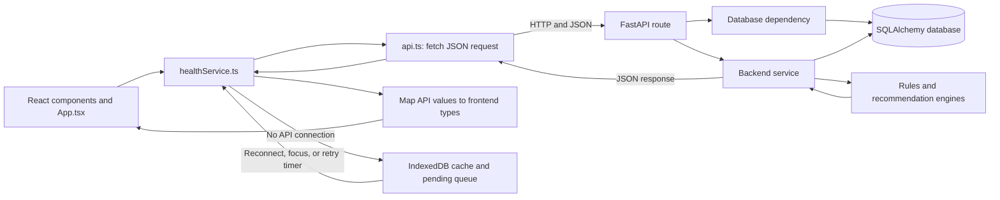

# Frontend and Backend Integration

## Overview

The browser-based React frontend communicates directly with the FastAPI backend over HTTP using JSON requests. The frontend keeps the API base URL in one place, translates API data into UI types, and stores selected responses locally for offline use.

The backend validates incoming requests, runs application services, stores data through SQLAlchemy, and returns JSON responses. The frontend then updates the dashboard with measurements, evaluations, alerts, and recommendations.

## Connection Configuration

The API client is implemented in `src/services/api.ts`.

- `VITE_API_URL` sets the backend base URL.
- If `VITE_API_URL` is not set, the frontend uses `http://localhost:8000`.
- A configured value without `http://` or `https://` is treated as an HTTPS host.
- One trailing slash is removed before endpoint paths are appended.

For local development, start the backend on port `8000` and the Vite frontend on port `5173`. The backend's default CORS configuration allows `http://localhost:5173` and `http://127.0.0.1:5173`. For another frontend origin, configure the backend's `CORS_ORIGINS` setting to include it.

The frontend environment value is embedded by Vite when the frontend starts or builds. Restart the Vite server after changing it. In a deployed environment, set `VITE_API_URL` to the reachable backend URL and configure `CORS_ORIGINS` on the backend to allow the deployed frontend origin.

## Request and Response Flow

For a measurement submission, the backend validates the request, checks the astronaut and mission environment, stores the measurement, evaluates its indicators, generates recommendations, saves the resulting alert, and returns an evaluation response. The frontend maps the response to its own health status and indicator types before displaying it.

## Endpoints Used by the Frontend

| Method | Endpoint | Purpose |
|---|---|---|
| `GET` | `/health` | Checks whether the API is reachable. |
| `GET` | `/api/v1/astronauts/` | Loads astronaut records. |
| `POST` | `/api/v1/astronauts/` | Creates an astronaut record. |
| `POST` | `/api/v1/measurements/` | Submits a measurement and receives its health evaluation. |
| `GET` | `/api/v1/measurements/?astronaut_id={id}` | Loads measurement history for an astronaut. |
| `GET` | `/api/v1/evaluations/` | Loads evaluation and alert history; can be filtered by astronaut. |
| `PATCH` | `/api/v1/evaluations/{id}/acknowledge` | Acknowledges an evaluation alert. |
| `POST` | `/api/v1/demo/simulator/tick` | Generates and evaluates one synthetic demo reading. |

The backend also exposes other routes, including environment threshold retrieval, individual record lookup, and astronaut updates/deletion. The current frontend does not call every backend route.

## Measurement Evaluation

1. A frontend component collects measurement values and calls a function in `src/services/healthService.ts`.
2. `healthService.ts` assigns a client measurement ID and timestamp, saves the submission in IndexedDB, and sends it through `src/services/api.ts`.
3. FastAPI routes the request to `backend/app/api/routes/measurements.py`, which delegates to `EvaluationService`.
4. `EvaluationService` validates the astronaut and environment, persists the measurement, and passes its values to the rules engine.
5. The rules engine applies environment thresholds and combination rules. The recommendation engine adds explanations and prioritized recommendations.
6. The backend saves the resulting alert and returns the evaluation as JSON.
7. On success, the frontend removes the queued copy, maps the response, and refreshes the dashboard.

The demo simulator uses a separate route to generate synthetic input, then sends it through the same evaluation service.

## Offline Behavior

`src/services/offlineStorage.ts` uses IndexedDB to store pending measurements and cache selected API responses. The frontend listens for browser online/offline events and retries pending submissions when the browser comes online, when the window regains focus, and on a periodic timer.

When the API cannot be reached, queued measurements remain on the device for a later sync attempt. Cached astronaut, measurement, and evaluation data can be used as a fallback for selected reads. This is browser-side offline support; it does not itself provide a mission communications link.

## Backend Data and Configuration

FastAPI registers the routes in `backend/app/main.py`. Route handlers obtain database sessions through `backend/app/api/deps.py` and `backend/app/core/database.py`. Pydantic schemas define request and response shapes, while SQLAlchemy models represent persisted astronauts, measurements, synchronization keys, and alerts.

In the default development configuration, the backend uses SQLite at `backend/astrohealth.db` and creates its tables at startup. Production deployment uses Alembic migrations. The backend's API URL, database URL, environment, and CORS origins are configured through backend settings and environment variables.

## Operational Notes

- Both frontend and backend must be running for API-backed dashboard features and the local simulator.
- `GET http://localhost:8000/health` is a quick check that the backend is available.
- The demo endpoint is disabled when the backend runs with `ENVIRONMENT=production`.
- The current API client sends JSON requests and handles HTTP errors, but this integration does not implement an authentication flow. A production deployment must define and implement its approved authentication and transport-security requirements.
- The demo uses synthetic readings; this integration is not certified clinical monitoring or a flight-ready telemetry system.
